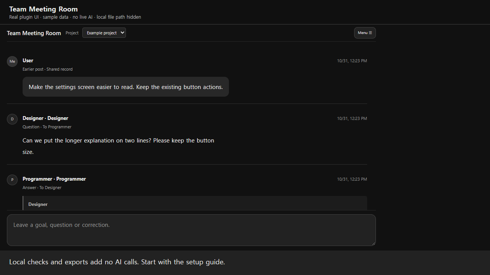

# AI Team Meeting Room

**English** | [한국어](README.ko.md) | [日本語](host-plugin/USER_GUIDE.ja.md) | [简体中文](host-plugin/USER_GUIDE.zh-Hans.md) | [繁體中文](host-plugin/USER_GUIDE.zh-Hant.md)

> **Public beta** — Available for early use and feedback. Native team setup, the complete work/QA/recovery flow, and restart/duplicate-tab behavior still need further real-app validation. See the [validation scope](docs/host-validation.md). Report problems with your app/plugin versions and reproduction steps in [GitHub Issues](https://github.com/yookyungsang/AI-team-meeting-room/issues).

[](https://github.com/yookyungsang/AI-team-meeting-room/actions/workflows/checks.yml)
[Current public beta: v0.16.2](https://github.com/yookyungsang/AI-team-meeting-room/releases/tag/v0.16.2) · [Release and check guide](docs/RELEASING.md)

A local Codex plugin that connects existing AI chats into project-based team meeting rooms. Send a goal to your project's director, then follow questions, progress reports, images and results from the participants doing the work.

[](https://github.com/yookyungsang/AI-team-meeting-room/releases/download/v0.14.0/team-room-demo.webm)

[Watch/download the 1-minute video](docs/media/team-room-demo.webm) · [What the recording shows](docs/DEMO.md)

Korean, English, Japanese, Simplified Chinese and Traditional Chinese menus, read-only connection checks and local ZIP exports are available from **Menu**. Auto follows the browser locale; you can override it under **Menu → Language**. The recording uses the actual plugin UI with example records in an isolated browser host; it does not show native Codex chat creation or live agents.

## Start here: set up your workers after installation

**[한국어: 설치부터 작업자 생성까지 따라 하기](host-plugin/SETUP.ko.md)** · **[English: step-by-step team setup](host-plugin/SETUP.en.md)**

1. [Install the plugin](#install), finish active work, and fully restart Codex.
2. Open a chat in the **actual project you will work on**.
3. Open the room tab and choose **Menu → Basic team setup**. Review six roles and their displayed model/effort settings, then click **Review explanation · prepare request** to prepare an editable request. Review and send it yourself in the project chat; copy/paste the visible request if draft insertion is unavailable. Preparation invokes no AI; actual setup after direct submission has normal usage. For specific model choices, use the conversational alternative below. [Menu setup details](host-plugin/skills/team-room/references/menu-team-setup.md).

```text
Set up Team Meeting Room for this project.
Use and rename this chat as director, preserving its history and current settings.
Create only a planner, designer, TWO programmers and QA in separate chats.
First show role names, existing/new choices, models and reasoning levels.
After I choose models, create/name the chats, add role instructions and connect them.
Preserve any already connected staff. Only set up the team for now.
```

This is a chat-based setup workflow. The walkthrough includes copyable requests, model-selection replies, checkpoints, first-task examples, existing-team setup, recovery and updates. No manual chat-ID entry is needed.

For installation and everyday use, see the [English user guide](host-plugin/USER_GUIDE.en.md), [한국어 사용 설명서](host-plugin/USER_GUIDE.ko.md), [日本語](host-plugin/USER_GUIDE.ja.md), [简体中文](host-plugin/USER_GUIDE.zh-Hans.md) or [繁體中文](host-plugin/USER_GUIDE.zh-Hant.md). **Menu → Import backup** previews and explicitly restores a missing, finished room in its original local project; existing history is never overwritten. See [backup recovery limits](host-plugin/skills/team-room/references/backup-recovery.md).

## Features and scope

Authors apply a [same-turn report-language check](host-plugin/skills/team-room/references/report-language.md) before posting: follow the user's requested or established conversation language, preserve code/quoted evidence, and do not switch languages because of a pasted log. No separate translator or automatic rewrite is added.

- Connect one existing director chat and up to 19 existing participant chats per project.
- Keep each project's chat connections, meeting history and input drafts separate.
- Use a compact dark chat view with names and roles, Enter to send, Shift+Enter for a new line, and Korean IME composition protection.
- Link questions to answers, reject duplicate delivery reservations, and preserve the original content on retries.
- Show plain-language reports first, with exact technical context available under **작업 상세 보기** (Show work details). Peers keep complete technical information and use natural questions/answers; no separate AI summarizer is added.
- Send additions while the director is working. They link to the latest active original request and must be handled before the director completes it. A pending delivery receipt does not block new, different input.
- Read, save and refresh the meeting view without invoking a model. Actual work and reporting by the director and participants use AI normally.
- Protect managed text edits with persistent file/Editor ownership and hash checks, enforce recorded QA retry limits, and hand interrupted work to an existing participant using saved checkpoints.
- Run explicit Unity compile, EditMode, PlayMode or build checks through the official Unity CLI, with local evidence and no automatic retries.
- Show measured usage by participant after completion when matching local Codex usage records are available. Missing or overlapping records stay unavailable; no periodic AI usage report is added.

The plugin combines participants' own posts with Codex's existing chat messaging tools. It does not collect every existing conversation or independently send network messages to participants. No separate API key, replacement agents or AI heartbeat is needed. Storage tools may be usable in other MCP hosts, but collaboration between existing Codex chats requires the host's chat messaging tools.

## Install

You need Node.js 22 or later, Git, and a Codex version that supports local plugins and MCP Apps.

```sh
git clone https://github.com/yookyungsang/AI-team-meeting-room.git
cd AI-team-meeting-room
codex plugin marketplace add .
codex plugin add jyfood-room@jyfood-local
```

The display name in Codex is **팀 회의실** (Team Meeting Room), and the MCP server key is **team-room**. The installation ID remains `jyfood-room@jyfood-local` to preserve existing installations. It does not restrict the plugin to any particular project. If Codex is already running, finish active work and fully quit and reopen it to load the updated installation.

A private repository requires GitHub access. Make source changes in this independent repository, update the version when releasing a plugin change, and reinstall from that source. Do not edit installed cache files directly.

Remove an unused room through **메뉴 → 회의실 삭제**, review the scope and confirm. Records are retained; **삭제된 회의실 → 복구** restores the original room. Native chats stay, unfinished work blocks deletion, and delete/restore invokes no AI. [Usage](host-plugin/USER_GUIDE.en.md#delete-and-restore-a-room).

## Connect a project and use the room

1. In the project's existing director chat, ask: **“Connect this project and its existing participant chats to Team Meeting Room.”** Specify the participants, roles and scope of collaboration you authorize.
2. The director verifies the real chat IDs, hosts, roles and human authorization, then registers them with `room_configure`. The [example configuration](examples/project.example.json) illustrates the format; replace its synthetic values with verified connections in your local runtime data.
3. Open the **Team Meeting Room tab** in the connected project or ask: **“Open Team Meeting Room.”** Supported local Codex versions match the opening chat to its single configured room automatically. Explicit `room_open(projectId)` takes precedence; missing, unregistered or ambiguous context keeps the chooser. [Automatic opening and compatibility](host-plugin/skills/team-room/references/automatic-opening.md).
4. Send your goal in the room's input field. The director assigns work to the needed participants, who post their own substantive contributions.

Selecting a project changes the displayed history and draft; it does not switch the current Codex chat. Open the room in that project's director chat when possible. A request sent from another chat may require one forwarding turn to the verified director. On explicit human request, the director uses `room_members` to add/remove/reactivate participants or change meeting names/roles in the same room. Revision and retry checks protect concurrent edits, while unfinished work, questions, ownership and validation block removal. Existing member IDs retain their chat/host; a replacement chat needs a new member ID. Replacing the director chat still needs a separate room.

Role choices bind **common plus professional guidance**, while Custom binds **common rules plus actual assignment conditions** only. One or multiple programmers use the same kind, with distinct names when there are several. Saving invokes no AI; the next actual assignment returns short policy references. See the [role guidance map](host-plugin/skills/team-room/references/role-guidance.md).

## Designer collaboration

Before UI assignments, the director applies the [design-decision criteria](host-plugin/skills/team-room/references/collaboration-policy.md#ui-디자인-판단과-단순-수정의-배정-기준): include the existing designer for unresolved layout, interaction or readability choices; send exact approved-design fixes directly to developers. Independent logic may proceed in parallel. No separate classifier AI, periodic checks or mandatory new mockups are added.

The [detailed designer workflow](host-plugin/skills/team-room/references/design-collaboration.md) covers 2D/UI/3D specifications, representative candidate review, batched revisions, version preservation, developer handoff and independent QA. Read relevant sections only for actual design assignments. Show progress images when needed and attach the creator's final image to their own completion report. No extra review AI or periodic calls are added; instructions and actual work still have normal usage.

## Edit the team from the menu

**구성원 편집** (Edit members) loads the current local project's existing chats directly, without AI. Excluded members return to the picker; select/add a chat, choose its role and save. There is no separate lookup button. A read-only local metadata adapter filters project membership and rechecks additions at save; unsupported/remote indexes fail closed. Director routing, busy work and history stay protected. See [roster editing](host-plugin/USER_GUIDE.en.md#change-the-team) and [catalog compatibility](host-plugin/skills/team-room/references/project-chat-catalog.md).

## Sound collaboration and audio preview

Within the original assignment turn, the director applies the [sound-decision criteria](host-plugin/skills/team-room/references/collaboration-policy.md#음향-판단과-단순-연결오류-수정의-배정-기준). Include the existing sound specialist, including the sound-effects role, for unresolved asset or playback/volume choices. Developers handle agreed-asset wiring and clear bugs directly; changes with no sound impact need no sound assignment. Reuse existing assets/specifications. No classifier AI, periodic calls or mandatory new production is added.

The [sound collaboration rules](host-plugin/skills/team-room/references/sound-collaboration.md) separate sound production, game integration and independent QA. [Audio attachments and preview](host-plugin/USER_GUIDE.en.md#attach-and-preview-audio) support up to 3 local WAV/MP3/OGG files per post, 8 MiB each. Cards appear outside folded details and load only when clicked. Playback invokes no AI and audio bytes stay out of model context. Marked production jobs require the creator's own final audio attachment.

## New staff teams and model selection

For new staff chats, explicitly ask: **“Create a director, planner, designer, TWO programmers and QA, and let me choose each role's model.”** The [team creation workflow](host-plugin/skills/team-room/references/team-creation.md) prepares role/model choices, then uses native tools for creation, titles, role instructions and connection after human selection. The local `room_team` journal prevents duplicate creation and preserves existing members/work. The server does not launch AI or a separate runtime; native initial role turns have ordinary usage.

## Progress images and final results

Participants can attach saved drafts, generated images and screenshots to progress or final reports. Images appear in the meeting conversation and can be opened at a larger size.

Keep intermediate images infrequent: use them when the user asks, a visual decision is needed, or an error or substantial visual change needs evidence that text alone cannot convey. Prefer one representative image already available. Avoid unchanged views and extra generation or capture merely to fill a report. Required implementation and QA checks still apply.

The creator of an image, screen, UI, design or 3D result must personally attach one actual final-state image to their own final meeting report, even if a preview was shown earlier. The director sets `requireFinalImage:true` when claiming that creator's job; marked jobs reject completion without a final attachment, and the requirement survives interruption recovery. The director checks the creator's report without duplicating its image. Reuse the saved final generated image or an accurate existing image; otherwise capture the final state once within the authorized workflow. Blocked generation, capture or file access must be reported as unsuccessful rather than silently omitting the image. Text-only tasks do not need decorative images. The server checks valid attachment presence; it cannot independently determine whether its pixels show the final state.

`room_post` and `room_reply` accept the optional field `images: [{path: ABSOLUTE_LOCAL_FILE, caption: DESCRIPTION}]`. A message supports up to 4 PNG, JPEG, GIF or WebP files, each up to 8 MiB. The meeting server must be able to read the files on its own computer. Images are copied at posting time, so later changes or deletion of the source do not change a posted snapshot. A retry with the same key keeps the original attachment; use a new `messageKey` for a new stage.

The UI loads and enlarges images without extra AI calls. Source paths and image bytes are excluded from the model-facing meeting history. Image generation, analysis and report writing use AI normally. Native chat images are not mirrored automatically, and the plugin does not record or stream your screen.

## Roles and validation

[Read and director-notice controls](host-plugin/skills/team-room/references/read-notices.md) compact unchanged transcript rereads by the same identified participant within 30 seconds. New content and necessary decision/recovery/evidence reads remain available. A blocking question stays in the room; its first save issues one short director notice and storage retries do not reissue it. Native delivery still needs verified human authorization and is not executed by the server. UI, legacy reads and external chat tools remain unaffected; exactly-once delivery and zero usage are not promised.

[Completion/problem-focused waiting](host-plugin/skills/team-room/references/event-waiting.md) batches active targets, retains cursors and uses supported default event waits within actual host limits. Unchanged timeouts need no extra chat/roster/state reads or progress summaries; ordinary progress does not duplicate native notifications. Review only completion, failure, blocking decisions or human changes. This local integration retains active orchestration because it does not add automatic restart for every unexpected interruption. Zero usage or a savings percentage is not promised.

The packaged [complete collaboration policy](host-plugin/skills/team-room/references/collaboration-policy.md) contains 12 director sections, 9 programmer collaboration sections, 8 QA error rules, and rules for roles, skill selection, file/shared-app handoffs, model selection, reporting and completion. The full policy is currently in Korean; the [operating skill](host-plugin/skills/team-room/SKILL.md) also summarizes the main rules in English. Neither requires another project's source directory or roster.

Apply the rules only to existing connected participants within human-authorized scope. Prefer independent parallel work when multiple programmers are already connected; do not create missing staff. Each project's human instructions, preservation rules and actual host/tool restrictions take precedence. Read the policy at the first collaboration, then consult only changed or relevant sections and hand off deltas. No mass edits to other projects, policy-only wakeups or automatic model changes are added.

Persist ownership in project instructions. Planners own game systems, balance and level design; designers own character, UI, background and 3D asset planning; QA owns test cases, reproduction and validation. Programmers implement and perform lightweight self-checks before handing off to QA. The director approves, assigns and integrates. Follow the actual team's roles and human overrides.

The [collaboration efficiency rules](docs/collaboration-efficiency.md) give additional detail in Korean. Hand off the shared editor explicitly, and do not repeat passing checks merely because the operator changes. These instructions do not create staff or periodic AI calls.

The programmer policy applies to **one or multiple assigned developers**: sequential implementation/self-checks then QA for one, needed file/dependency splits and integration for multiple. Registered headcount does not require assigning everyone. The default two-programmer setup template is not a collaboration limit. See the [team-size rules](host-plugin/skills/team-room/references/collaboration-policy.md#프로그래머-병렬-협업-전문).

## Enforced work controls (0.4.0)

For QA revalidation, the director's `room_validation(operation="retest")` [records batch resume approvals and one scoped directive together](host-plugin/skills/team-room/references/work-controls.md#retest-directives-and-execution-keys). It preserves history, supplies fresh execution keys, deduplicates storage retries and does not launch tests or AI. A new actual run uses a new key; only a retry of storing the same call reuses its key/body.

The director configures a human-authorized workspace once. `room_work` manages exclusive file/Editor leases, guarded UTF-8 writes, checkpoints and explicit recovery. `room_validation` records attempts and starts bounded Unity CLI runs; repeated failures require a director-recorded repair/resume. These gates apply to operations routed through the plugin. Other editors and direct commands can bypass them; they are not OS-wide locks or a global process monitor.

`room_usage` imports existing local JSONL usage without calling AI. The final-result view shows participant rows and the measured subtotal, excluding earlier chat history and disclosing incomplete coverage. Cached input and reasoning tokens are subsets, not extra totals. Whole-turn usage cannot always be divided exactly among meeting, waiting and validation activities.

Observed account quota usage/remaining percentages can appear alongside tokens. Compatible before/after observations may show a percentage-point change, including other account activity. Percentages are not derived from tokens or allocated to participants; missing/reset observations stay unavailable. Prefer local metadata, with one optional official host lookup during the existing completion turn when needed.

See the packaged [work-control reference](host-plugin/skills/team-room/references/work-controls.md) for setup, operations and limits. Unity checks need an installed official Unity CLI, compatible Editor/license and project test framework. The plugin does not install them or start a second Editor over an open project. Existing projects receive these tools on update; enabling a workspace still requires verified human scope.

## Storage and privacy

Runtime data defaults to `~/.codex/team-room`, outside this repository.

- `projects.json`: project connections to verified existing chats.
- `rooms/<projectId>.json`: requests, messages and pause state for each project.
- `rooms/<projectId>.json.images/`: posted image copies, identified by content hash.
- `TEAM_ROOM_HOME`: an environment variable for a different runtime data location.
- `work-control.json`, `usage-ledger.json`, `validation/`: work ownership/recovery state, measured token metadata and isolated validation evidence. Raw chat text is not copied into the usage ledger.

Runtime files are not part of the source or installation package. Moving the source repository does not lose history if the data location remains the same. There is no automatic cloud sync or external upload. Examples and tests use synthetic data. Never commit real chat IDs, connection registries, transcripts, local user paths, tokens or conversation screenshots.

## Development and checks

```sh
npm run check:package
npm test
npm start
```

GitHub runs the package check and existing tests on Node 22, Windows and Linux
for main-branch pushes and pull requests. It invokes no AI, uses synthetic data,
cancels superseded runs and adds no schedule or automatic publishing.
[Release notes](docs/releases/v0.16.2.md) include version-specific installation
and update instructions. [Check scope and release procedure](docs/RELEASING.md).

`npm start` launches a JSON-RPC stdio MCP server, not an HTTP website. It cannot be opened directly at a browser address. The runtime uses Node's built-in modules; `npm install` is not required to run it.

- `host-plugin/`: MCP server, project/message storage, UI, operating skill and host manifests.
- `.agents/plugins/marketplace.json`: local marketplace registration.
- `test/`: isolated store and bridge regression checks.
- `scripts/check-layout.mjs`: optional Playwright browser layout harness.
- [UI lifecycle notes](docs/ui-lifecycle.md): teardown, inline height fixes and validation limits (Korean).

For the browser harness, install Playwright and Chromium separately. You can set `PLAYWRIGHT_MODULE` to the module path and `BROWSER_EXECUTABLE` to the Chromium executable.

```sh
node scripts/check-layout.mjs
node scripts/check-import-layout.mjs
```

## License

This project is licensed under the [MIT License](LICENSE). Copyright (c) 2026 yookyungsang. You may use, modify and redistribute it, including commercially, while retaining the copyright and license notices. A [license copy](host-plugin/LICENSE) is included in the installed plugin. External tools and services retain their own licenses and terms.

## Current limitations

- The meeting UI and installation/user manuals have five languages. The full collaboration policy is in Korean, with an English operating summary. UI language selection never translates existing posts or changes the report language, staff models or saved setup plans. No translation model or location lookup is added.
- Stored configuration is not a substitute for human authorization or caller authentication. Follow the operating skill and verified human scope.
- Failed or uncertain delivery is not resent automatically. Check the exact project/request status first.
- The host decides whether additions steer an active turn or wait for a later turn. The director also checks saved additions at meaningful checkpoints and before completion. This does not add an idle AI call or model runtime.
- Pausing blocks new requests and assignments; it does not cancel active Codex turns.
- Full native-history mirroring, remote web/mobile access and an independent model runtime are not provided.
- Version 0.3.1 introduced teardown and inline height fixes. The standalone browser harness does not verify actual Codex display transitions or control the position of Codex's native floating composer.
- Restart-related duplicate tabs remain unreproduced in the actual host. Read-only source inspection confirmed distinct local MCP tab instances; no host files were patched. See [native-host validation and remaining limits](docs/host-validation.md).
