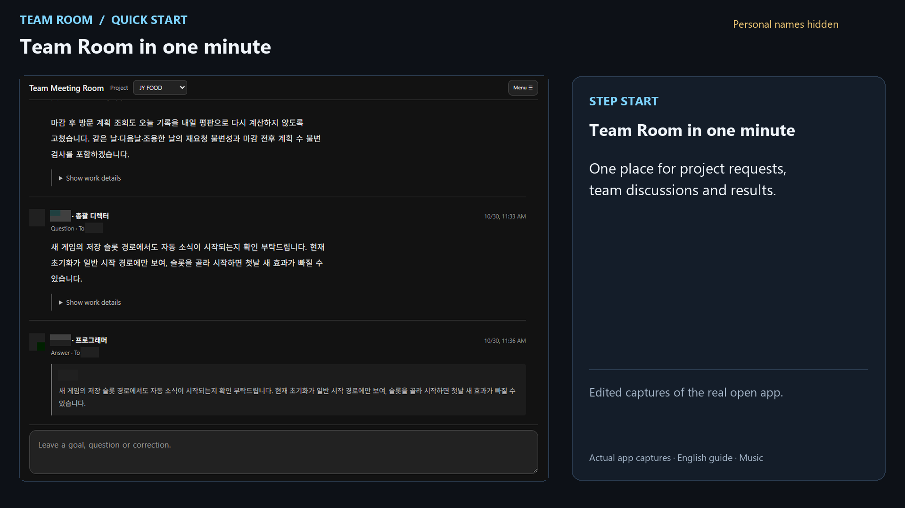
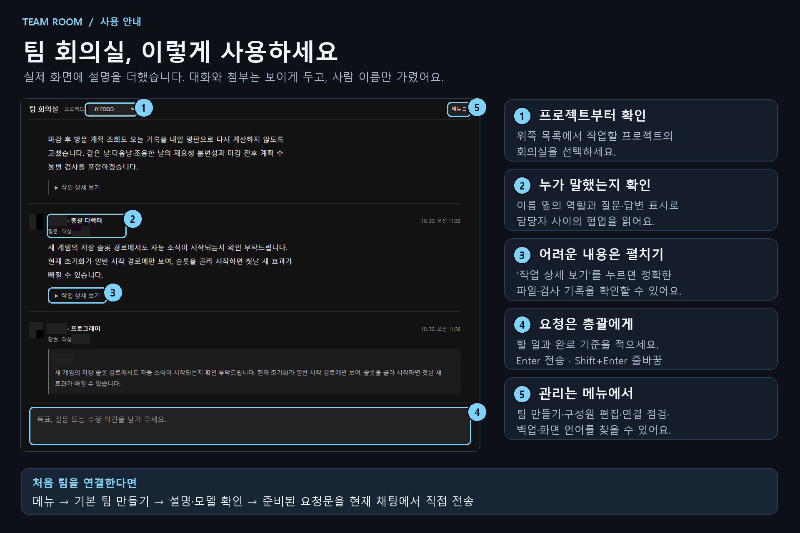

# Team Room walkthroughs / 회의실 사용 영상

[English video · 1 minute](https://github.com/yookyungsang/AI-team-meeting-room/releases/download/v0.16.2/team-room-walkthrough.en.mp4) ·
[한국어 영상 · 1분](https://github.com/yookyungsang/AI-team-meeting-room/releases/download/v0.16.2/team-room-walkthrough.ko.mp4) ·
[한국어 설명 스크린샷](media/team-room-guide.ko.png)

[](media/team-room-walkthrough.en.mp4)

These new walkthroughs use captures of the real open Codex MCP App, edited into
ten short chapters. The English version captures the actual English menus;
the Korean version uses the Korean menus. Original project messages, custom
role labels and the game attachment retain their original language. Personal
names in headings, prose, quotes and member fields are masked. The project
owner reviewed the finished media and explicitly approved GitHub publication.

Transparent capture backgrounds were corrected locally using the saved native
views. These are edited screen captures, not generated interface mockups or a
continuous recording of agents working. No team was created, request sent or
roster change saved during capture. The connection check includes real
**Needs attention** items; it is not an all-green integration certification.

| Time | What to do |
| --- | --- |
| 0:00 | See the meeting view |
| 0:05 | Choose a project |
| 0:11 | Review basic team setup, roles and models |
| 0:20 | Manage existing participants and roles |
| 0:28 | Write a request and completion criteria |
| 0:36 | Follow questions and replies |
| 0:41 | Open work details |
| 0:45 | View an attachment outside folded details |
| 0:49 | Enlarge the image |
| 0:52 | Check the connection and find backup controls |

The same original 60-second instrumental track, made with **ElevenMusic**
(ElevenLabs Music v2), is embedded in both versions at a low volume with fades.
There is no spoken narration. The raw music file is not distributed as an asset
library. See [media credits and terms](media/NOTICE.md).

Repository copies: [English MP4](media/team-room-walkthrough.en.mp4),
[한국어 MP4](media/team-room-walkthrough.ko.mp4),
[English VTT](media/team-room-walkthrough.en.vtt),
[한국어 VTT](media/team-room-walkthrough.ko.vtt).
Clone or download the repository, then open the [local player](media/walkthrough.html).
GitHub displays HTML source rather than hosting that player.

## 한국어 안내

실제로 열어 둔 회의실을 촬영해 한국어·영어 설명과 배경음악을 넣은 1분 영상입니다.
사람 이름만 가리고 대화 내용과 첨부 그림은 소유자의 승인에 따라 공개합니다.
영문 메뉴도 실제 앱에서 전환해 촬영했으며, 기존 프로젝트 대화는 번역하지 않았습니다.
팀 만들기는 설명만 열었고 새 채팅 생성·요청 전송·구성원 저장은 실행하지 않았습니다.
원본 캡처·대화 데이터·연결 정보·로컬 편집 파일은 저장소에 포함하지 않았습니다.



## Earlier isolated example demo · v0.14.0

The earlier recording below uses synthetic example records in an isolated host.
It is retained for the reproducible export/audio demonstration and differs from
the newly approved real-app walkthroughs above.

[Watch or download the 1-minute WebM](media/team-room-demo.webm) ·
[English captions](media/team-room-demo.en.vtt) ·
[한국어 자막](media/team-room-demo.ko.vtt)


This is a recording of the actual packaged widget and local meeting-store
implementation, running in an isolated browser host with synthetic project/chat
metadata and example posts. The host label stays visible throughout. No live AI
participants, native Codex chat creation, generated mock screens or paid media
APIs are used. Local backup paths are hidden. This is not a recording of native
Codex approval or display transitions; those remain separate integration checks.

The video shows conversation and work details (0:00), image preview (0:12),
audio preview (0:17), language selection (0:22), connection checks (0:27) and
verified ZIP export/download (0:34). English captions are visible in the recording;
the VTT files provide English and Korean subtitle tracks in compatible players.

### 이전 예시 영상 · 한국어

실제 플러그인 UI와 로컬 회의 저장 기능을 실행한 화면입니다. 공개용 예시
프로젝트·채팅 정보와 예시 발언을 사용하며 실제 에이전트는 호출하지 않습니다.
영상 전체에 예시 실행임을 표시하고 로컬 백업 경로는 가렸습니다.
없는 기능을 그린 목업이나 Codex의 실제 승인·새 채팅 생성 영상이 아닙니다.

대화·작업 상세·이미지 확대·음원 미리듣기·한영 전환·연결 점검·ZIP 저장과
다운로드를 보여 줍니다. [로컬 플레이어](media/demo.html)를 내려받은 소스에서
열거나 WebM 파일을 재생하세요. GitHub에서 HTML 링크는 소스 보기로 열립니다.

### Reproduce the earlier example without live AI

Optional authoring dependencies: Playwright with an available Chrome/Chromium,
Python and OpenCV with VP8 encoding. These are not plugin runtime dependencies.
The scripts do not install browsers or packages automatically.

```sh
node scripts/record-demo.mjs
python scripts/encode-demo.py
```

Set `PLAYWRIGHT_MODULE` and `BROWSER_EXECUTABLE` when those dependencies are
outside normal module/browser discovery. The recording uses loopback only and
isolated `.local/demo-data` / `.local/demo-recording` directories. It never reads
the real room home or any user's Codex rollouts. Review public media before a
release; never replace the fixture with a user's roster or private transcripts.
